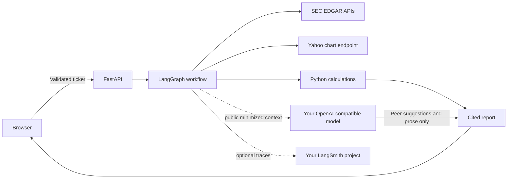
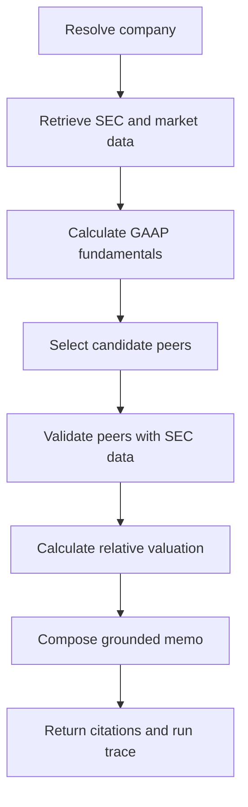
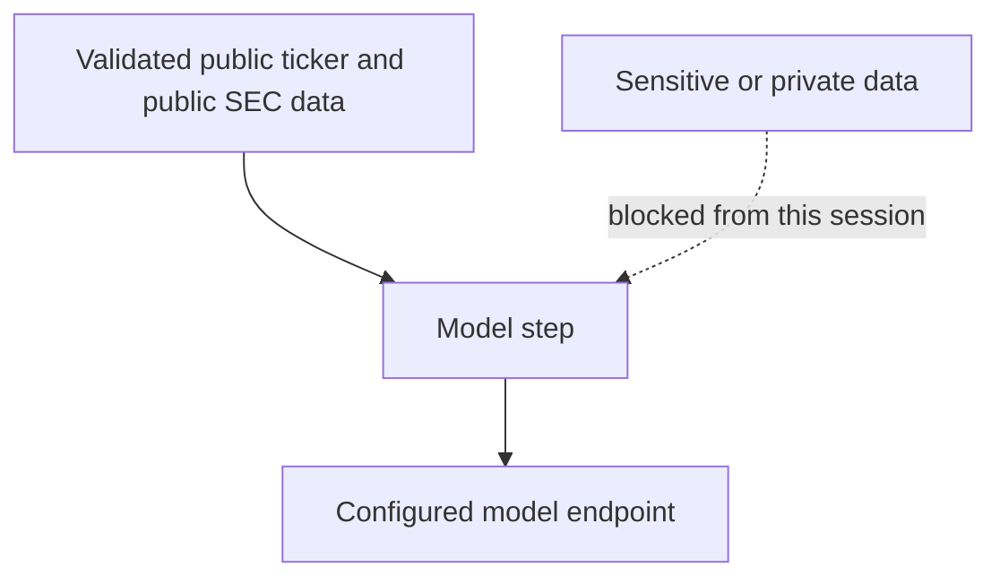

# Ledger

Ledger is a local AI financial-research agent for SEC-reporting U.S. public companies. Enter a ticker
and it retrieves live SEC Company Facts, the latest filing metadata, and current market history;
calculates financial and valuation metrics in Python; validates comparable companies; and produces a
cited research memo through a LangGraph workflow.

There is no simulated company data. A configured model can choose candidate peers and write the memo,
but Python owns every number and the valuation verdict. Without a model key, Ledger uses a transparent
deterministic fallback and consumes no model credits.

## Run locally

Prerequisites: Python 3.12+, Node.js 22+, and Git.

```powershell
git clone YOUR_GITHUB_REPOSITORY_URL
cd financial_research_agent
Copy-Item .env.example .env
```

Open `.env` and set at least a real SEC contact identity:

```dotenv
SEC_USER_AGENT="Ledger Research your-email@example.com"
OPENAI_API_KEY="your-provider-key"
OPENAI_MODEL="gpt-5-mini"
OPENAI_BASE_URL="https://api.openai.com/v1"
MODEL_PROVIDER="OpenAI"
```

The API key belongs to **your model-provider account**. Usage and credits are billed by that provider;
the project does not include shared keys or credits. Any provider exposing an OpenAI-compatible
`/chat/completions` endpoint can be used by changing `OPENAI_BASE_URL`, `OPENAI_MODEL`, and
`MODEL_PROVIDER`.

Install and start:

```powershell
py -3.12 -m venv .venv
.venv\Scripts\python.exe -m pip install -r requirements.txt
npm install
npm run dev
```

Open <http://127.0.0.1:5173>. To run without a model, leave `OPENAI_API_KEY` blank.

Docker is also supported:

```powershell
Copy-Item .env.example .env
docker compose up --build
```

Then open <http://127.0.0.1:8000>.

## Which companies work?

Ledger accepts a ticker from the SEC company index, including formats such as `AAPL`, `NVDA`, and
`BRK.B`. It works best for U.S. operating companies that file 10-K/10-Q statements with comparable
US-GAAP facts and have a Yahoo Finance price series. Funds, private companies, many foreign issuers,
and companies with incomplete XBRL facts may return an evidence error instead of a report.

When a model is configured, it proposes two relevant peers. Every proposed ticker is resolved against
the SEC index and its figures are independently retrieved before it can enter the comparison. Without a
model, Ledger uses a small SEC-industry fallback cohort. Missing peers reduce confidence; they are never
replaced with invented values.

## Architecture





Detailed diagrams and component boundaries are in [docs/ARCHITECTURE.md](docs/ARCHITECTURE.md).

## LangSmith observability

LangSmith tracing is optional and disabled by default. To enable it for your own LangSmith account:

```dotenv
LANGSMITH_TRACING="true"
LANGSMITH_API_KEY="your-langsmith-key"
LANGSMITH_PROJECT="ledger-financial-research"
```

LangGraph reads these standard environment variables automatically. The repository does not include a
LangSmith key. Review [docs/SECURITY.md](docs/SECURITY.md) before enabling tracing. LangSmith’s official
setup uses `LANGSMITH_API_KEY` and `LANGSMITH_TRACING=true`.

## Security boundary

Ledger enforces the agent access triangle: no agent step may simultaneously hold untrusted input,
sensitive/private data, and external egress.



The model session uses two capabilities: bounded external input and model-provider egress. Sensitive
data access is absent. The runtime check in `backend/app/security.py` rejects a three-capability
session. Model endpoints must use HTTPS unless they are local, secrets remain outside graph state, and
the model has no write, messaging, trading, filesystem, or database tools. See
[docs/SECURITY.md](docs/SECURITY.md) for the threat model and future-feature rules.

## Verify

```powershell
npm run check
openspec validate --all --strict
```

`npm run check` runs TypeScript checking, ESLint, Python unit tests, and the production build. Tests do
not call a paid model. Live smoke tests require SEC and market-network access.

## Project artifacts

- [Editable private design source desktop/mobile design](PRIVATE_DESIGN_SOURCE_REMOVED)
- [Architecture](docs/ARCHITECTURE.md)
- [Security and access triangle](docs/SECURITY.md)
- [Design review](docs/DESIGN_REVIEW.md)
- [AI operations](AI_OPS.md)
- [Project handoff](HANDOFF.md)

Ledger is a research aid, not investment advice. Verify primary filings before making a decision.
