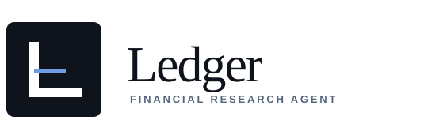
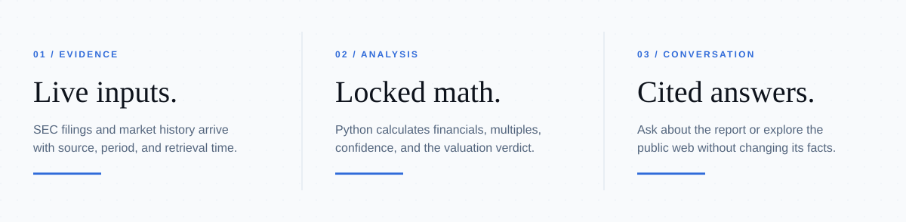
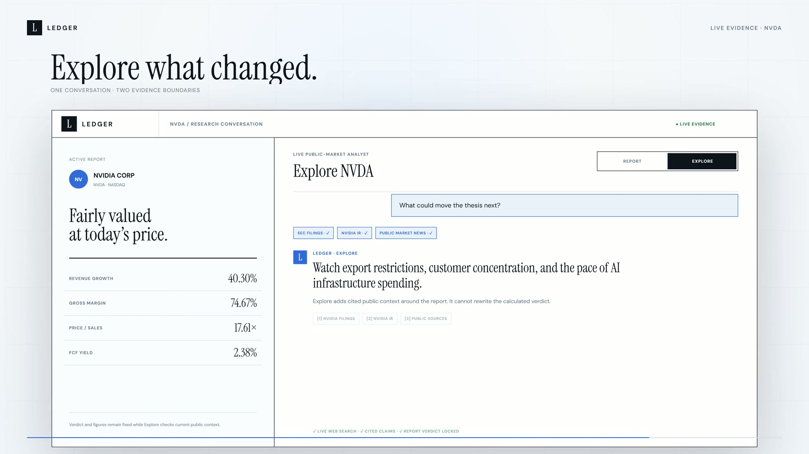
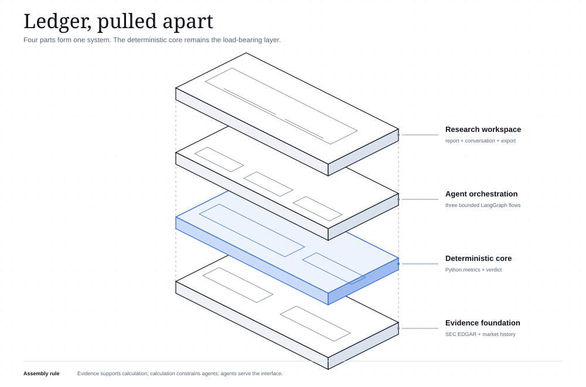

<p align="center">
  
</p>

<p align="center">
  <strong>Public-company research built from live evidence, deterministic math, and cited answers.</strong><br>
  SEC filings + market prices in. A reviewable investment memo out.
</p>

<p align="center">
  
  
  
  
</p>

<p align="center">
  
</p>

<p align="center">
  <a href="artifacts/video/ledger-launch.mp4"></a>
</p>

<p align="center">
  <strong><a href="artifacts/video/ledger-launch.mp4">Watch the 51-second launch film</a></strong>
  · <a href="artifacts/video/ledger-launch-vertical.mp4">Vertical cut</a>
</p>

## Start

Requires Python 3.12+, Node.js 22+, Git, and a real contact address for the SEC user agent.

```powershell
git clone https://github.com/prentopoulos/financial-research-agent.git
cd financial-research-agent
Copy-Item .env.example .env
py -3.12 -m venv .venv
.venv\Scripts\python.exe -m pip install -r requirements.txt
npm install
npm run dev
```

Set `SEC_USER_AGENT` in `.env`, then open <http://127.0.0.1:5173>. Add your own
`OPENAI_API_KEY` to enable model-written reports and chat. Your provider account pays for usage;
Ledger includes no shared key or credits.

## Research

Enter a public-company ticker such as `NVDA`, `AAPL`, `XNDU`, `QNT`, or `BRK.B`. Ledger resolves the
issuer, retrieves the latest usable filings and price history, calculates the financial profile in
Python, verifies peers, and produces a cited report. Missing evidence lowers confidence or stops the
run. Company data is never simulated.

<p align="center">
  
</p>

Recent listings and foreign issuers are supported when usable consolidated XBRL facts and market
history exist. Read the [architecture notes](docs/ARCHITECTURE.md) for period selection, peer
verification, and failure behavior.

## Ask

Every completed report becomes a grounded conversation.

| Mode | Best for | Evidence boundary |
|---|---|---|
| **Report** | Figures, verdict, peers, risks, and method | The immutable verified report; no browsing |
| **Explore** | Current news, industry shifts, and wider market context | The report plus one cited public-web search |

Expand the chat to make it the workspace focus, then return to the report without losing the thread.
Answers can cite only validated evidence links. Report mode works with OpenAI-compatible chat models;
Explore requires OpenAI Responses with `web_search` permission.

## Architecture

<p align="center">
  
</p>

Python owns financial calculations and the valuation verdict. LangGraph routes three workflows:
`company-research`, `report-chat`, and `market-explore`. FastAPI enforces request boundaries, React
renders the workspace, and the model interprets evidence without changing locked figures.

<p align="center">
  
</p>

The exploded view shows the dependency order: public evidence supports deterministic analysis,
analysis constrains the agent workflows, and those workflows serve the research workspace.

## Security

<p align="center">
  
</p>

Each agent session may hold at most two of these capabilities: untrusted input, sensitive data, and a
way to send data out. Current sessions accept bounded public input and call approved HTTPS services;
they receive no sensitive data. The runtime rejects any three-capability configuration. Read the
[security model](docs/SECURITY.md) for the controls and extension rules.

## Observe

LangSmith tracing is optional. Enable it in `.env` to inspect graph steps, model calls, latency,
verifier outcomes, and token usage for research and both chat modes.

```dotenv
LANGSMITH_TRACING="true"
LANGSMITH_API_KEY="your-langsmith-key"
LANGSMITH_PROJECT="ledger-financial-research"
```

Keep tracing disabled if you extend Ledger with private data until you add the redaction and
isolation described in the security model.

## Commands

| Command | Action |
|---|---|
| `npm run dev` | Start the API and web app |
| `npm run check` | Typecheck, lint, test, and build |
| `docker compose up --build` | Run the containerized app on port 8000 |
| `python scripts/generate_docs_diagrams.py` | Rebuild the four documentation diagrams |

Reports export as editable Markdown or a paginated PDF with clickable evidence links. See the
[diagram gallery](docs/ARCHITECTURE.html), [conversation design](docs/CONVERSATIONAL_AGENT_RESEARCH.md),
and [AI operations guide](AI_OPS.md) for the full implementation notes.

Ledger is a research aid, not investment advice. Verify primary filings before making a decision.
