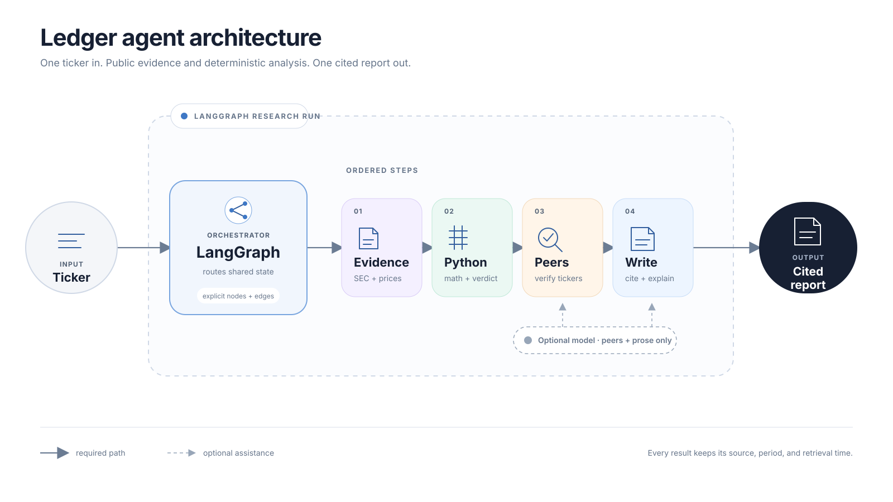
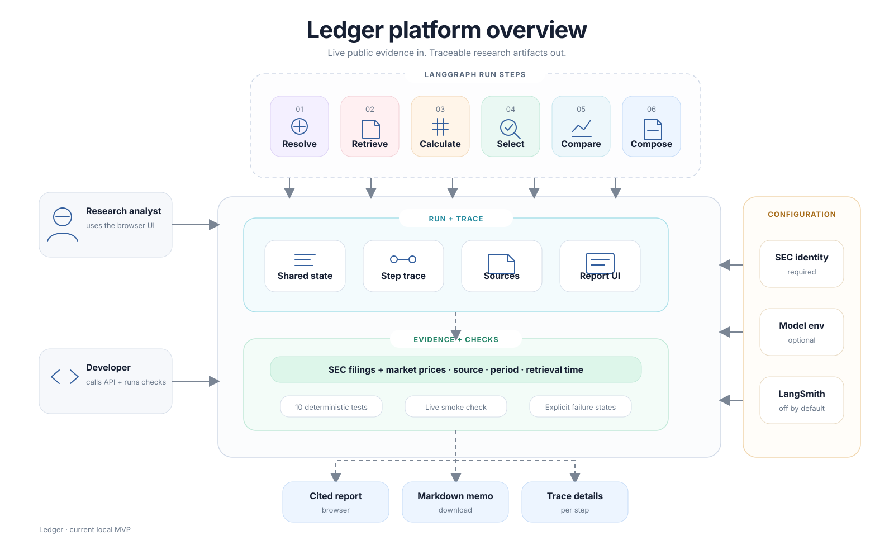
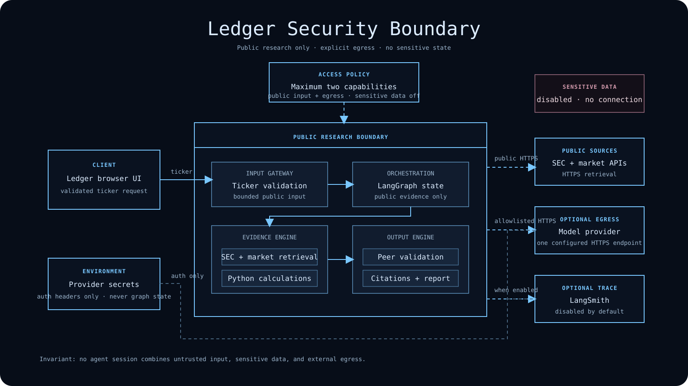

# Ledger

> Evidence-first public-company research from live SEC filings and market prices, with deterministic
> calculations and optional model-assisted writing.

Ledger is a local AI financial-research agent for SEC-reporting public companies. Enter a ticker
and it retrieves live SEC Company Facts, the latest filing metadata, and current market history;
calculates financial and valuation metrics in Python; validates comparable companies; and produces a
cited research memo through a LangGraph workflow.

Each completed report also opens a company-scoped research conversation. Questions are answered from
the active report's typed financial, valuation, peer, risk, and source objects. A model can explain and
connect that evidence; without a model key, a clearly labelled deterministic answerer handles common
report questions without consuming credits.

There is no simulated company data. A configured model can choose candidate peers and write the memo,
but Python owns every number and the valuation verdict. Without a model key, Ledger uses a transparent
deterministic fallback and consumes no model credits.

## Run locally

Prerequisites: Python 3.12+, Node.js 22+, and Git.

```powershell
git clone YOUR_GITHUB_REPOSITORY_URL
cd financial_research_agent
Copy-Item .env.example .env
```

Open `.env` and set at least a real SEC contact identity:

```dotenv
SEC_USER_AGENT="Ledger Research your-email@example.com"
OPENAI_API_KEY="your-provider-key"
OPENAI_MODEL="gpt-5-mini"
OPENAI_BASE_URL="https://api.openai.com/v1"
MODEL_PROVIDER="OpenAI"
```

The API key belongs to **your model-provider account**. Usage and credits are billed by that provider;
the project does not include shared keys or credits. Any provider exposing an OpenAI-compatible
`/chat/completions` endpoint can be used by changing `OPENAI_BASE_URL`, `OPENAI_MODEL`, and
`MODEL_PROVIDER`.

Install and start:

```powershell
py -3.12 -m venv .venv
.venv\Scripts\python.exe -m pip install -r requirements.txt
npm install
npm run dev
```

Open <http://127.0.0.1:5173>. To run without a model, leave `OPENAI_API_KEY` blank.

Docker is also supported:

```powershell
Copy-Item .env.example .env
docker compose up --build
```

Then open <http://127.0.0.1:8000>.

## Which companies work?

Ledger accepts a ticker from the SEC company index, including formats such as `AAPL`, `NVDA`, `XNDU`,
`QNT`, and `BRK.B`. The evidence engine supports:

- 10-K, 20-F, and 40-F annual reporting;
- structured annual financials from S-1, F-1, 424B3, and 424B4 prospectuses;
- trailing-twelve-month figures from four reported quarters or annual-plus-YTD reconciliation;
- standard US-GAAP/IFRS concepts and conservatively matched issuer-extension concepts; and
- a recent-listing mode that annualizes the latest comparable interim period and caps confidence at Low.

Annualized interim figures are calculations from reported periods, not simulated company data. The UI,
export, method note, and trace label the exact evidence basis. Funds, private companies, issuers without
usable consolidated XBRL facts, and symbols without a market-price series may still return an evidence
error instead of a report.

When a model is configured, it proposes two relevant peers. Every proposed ticker is resolved against
the SEC index and its figures are independently retrieved before it can enter the comparison. Without a
model, Ledger uses a small SEC-industry fallback cohort. Missing peers reduce confidence; they are never
replaced with invented values.

## Ask Ledger

Use **Ask Ledger** after a report completes to question the evidence already on screen. The browser
sends only the report run ID, a public-company question, and at most eight recent turns. The server
rebuilds a typed virtual ontology from its verified report snapshot on every turn, then validates the
answer's evidence IDs before returning source links.

Conversation is read-only and process-local: it has no web browser, uploads, private portfolio data,
database writes, messages, or trading tools. Reports expire after 30 minutes, conversations reset when
the server restarts, and each run accepts at most 24 questions. Links and common credential patterns
are rejected before a model call.

## Architecture



Read left to right: one ticker enters a LangGraph run, passes through four visible steps, and leaves
as a cited report. A second bounded graph turns that immutable report into cited conversational
answers. The model is optional and never owns the numbers.

[Read the concise architecture](docs/ARCHITECTURE.md) · [Open the standalone HTML version](docs/ARCHITECTURE.html)

### Platform overview



## LangSmith observability

LangSmith tracing is optional and disabled by default. To enable it for your own LangSmith account:

```dotenv
LANGSMITH_TRACING="true"
LANGSMITH_API_KEY="your-langsmith-key"
LANGSMITH_PROJECT="ledger-financial-research"
```

LangGraph reads these standard environment variables automatically. The repository does not include a
LangSmith key. Review [docs/SECURITY.md](docs/SECURITY.md) before enabling tracing. LangSmith’s official
setup uses `LANGSMITH_API_KEY` and `LANGSMITH_TRACING=true`.

Research runs appear as `company-research`; report conversations appear as `report-chat`. Both include
workflow, ticker, report run ID, and model-configuration metadata so they can be filtered independently.

## Security boundary

Ledger enforces the agent access triangle: no agent step may simultaneously hold untrusted input,
sensitive/private data, and external egress.



The model session uses two capabilities: bounded external input and model-provider egress. Sensitive
data access is absent. The runtime check in `backend/app/security.py` rejects a three-capability
session. Model endpoints must use HTTPS unless they are local, secrets remain outside graph state, and
the model has no write, messaging, trading, filesystem, or database tools. See
[docs/SECURITY.md](docs/SECURITY.md) for the threat model and future-feature rules.

## Verify

```powershell
npm run check
openspec validate --all --strict
```

`npm run check` runs TypeScript checking, ESLint, Python unit tests, and the production build. Tests do
not call a paid model. Live smoke tests require SEC and market-network access.

## Project artifacts

- [Architecture](docs/ARCHITECTURE.md)
- [Conversational-agent research](docs/CONVERSATIONAL_AGENT_RESEARCH.md)
- [Security and access triangle](docs/SECURITY.md)
- [Design review](docs/DESIGN_REVIEW.md)
- [AI operations](AI_OPS.md)
- [Project handoff](HANDOFF.md)

Ledger is a research aid, not investment advice. Verify primary filings before making a decision.
