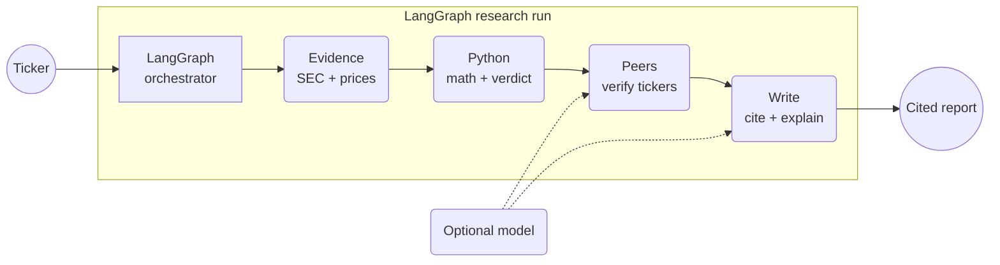
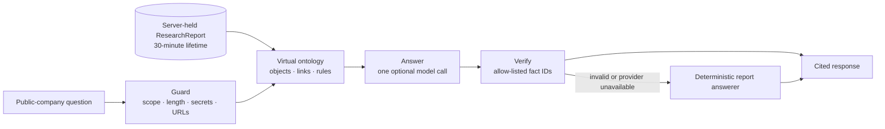
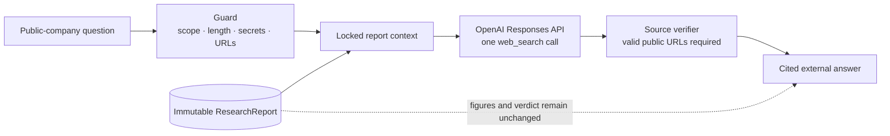

# Ledger agent architecture

One ticker enters one bounded LangGraph research run. The completed report becomes immutable context
for separate Report and Explore conversation graphs.

- **Required path:** public evidence, Python calculations, verified peers, cited output.
- **Optional model:** suggests peers and helps write prose; it never owns the numbers.
- **Audit trail:** every result keeps its source, period, and retrieval time.

## Report conversation

The ontology is a Python projection of the verified report contract. It defines `Company`,
`ReportRun`, `FinancialMetric`, `ValuationMetric`, `Peer`, `Claim`, and `Source` objects plus their
links and rules. No graph database or embedding index is needed for the bounded MVP. The model has no
tools and cannot refresh data, calculate financials, change the verdict, browse, or write externally.

The browser sends a run ID, a question, and at most eight recent messages. It never sends an editable
copy of the report. The server resolves citations from its own evidence map, which prevents a generated
URL from becoming a source.

## Live market exploration

Explore uses a third LangGraph workflow. It can retrieve current public web context, but it cannot
change report objects, recalculate figures, execute trades, write to another system, or access private
data. The API response must contain at least one valid HTTP or HTTPS source before the answer is shown.
External sources are kept distinct from the report's evidence ledger.

Open the [white system map](ARCHITECTURE.html).
