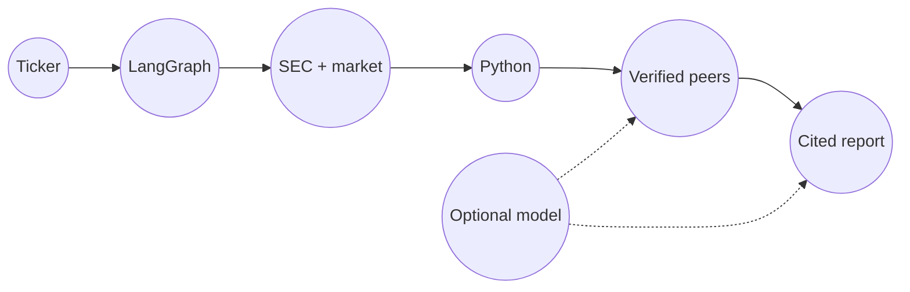

# Ledger architecture

One bounded graph turns a ticker into a cited report.

- **LangGraph** moves shared research state through explicit nodes.
- **Python** owns every figure and the valuation verdict.
- **The model is optional:** candidate peers and prose only.
- **The end state is auditable:** evidence basis, citations, and trace.

Open the [visual architecture](ARCHITECTURE.html).
