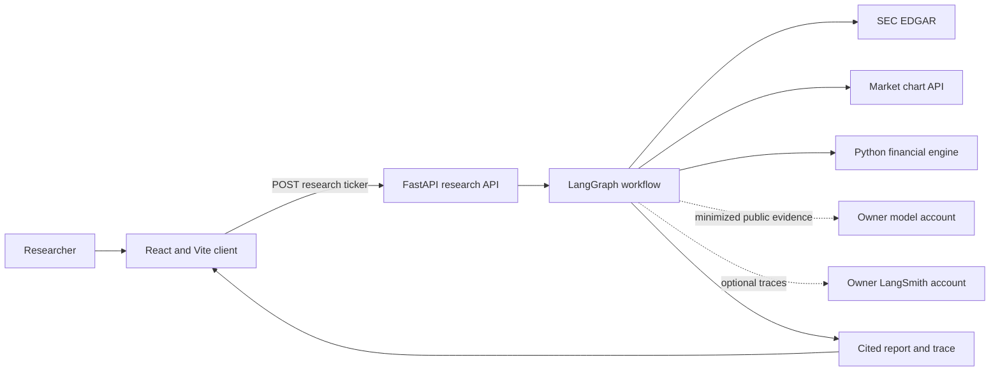
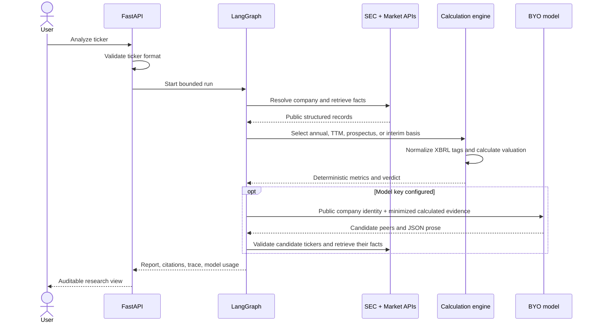
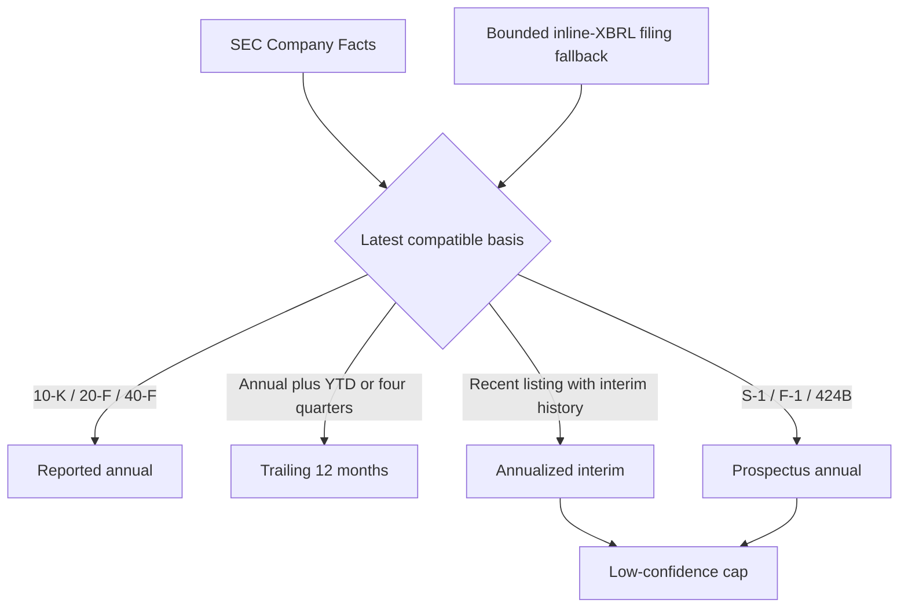

# Ledger architecture

## Runtime components

## Agent responsibilities

The model never calculates financial figures or changes the verdict. Invalid model output is rejected;
provider failure returns the deterministic memo. Candidate peers enter the table only after SEC
resolution and independent calculation.

## Filing compatibility

The inline-XBRL fallback reads a bounded set of SEC documents only when Company Facts has limited
history. It joins split document sets, excludes dimensional breakdowns from operating totals, sums
share-class facts when no consolidated share count exists, and never asks the language model to infer a
missing number.

## Data ownership

| Data | Owner/source | Persistence | Sent to model |
|---|---|---|---|
| Ticker | User | In-memory request only | Yes, normalized |
| Company facts | SEC | In-memory run only | Selected calculated fields only |
| Market price | Yahoo chart endpoint | In-memory run only | Selected calculated fields only |
| API keys | User environment | `.env`, Git-ignored | Never |
| Report | User | Browser memory / explicit Markdown export | Model prose becomes part of report |
| Trace | Local UI; optional LangSmith | No local database | Public run data only when enabled |

The MVP has no PostgreSQL memory, trading authority, messaging capability, or background scheduler.
