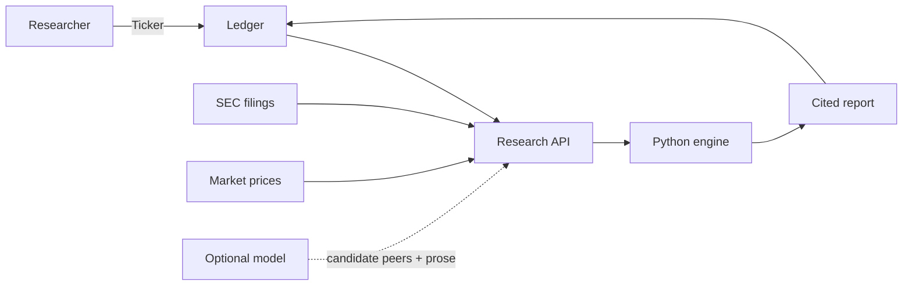
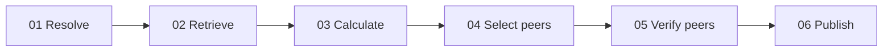

# Ledger architecture

Live public data enters once. Python calculates the numbers. Ledger returns a cited research memo.

## System map

The model is optional. It may suggest peers and write prose from minimized public evidence, but it
does not calculate figures or change the valuation verdict.

## One research run

- **Resolve:** match the ticker to an SEC company.
- **Retrieve:** load filings, company facts, and market history.
- **Calculate:** normalize periods and calculate metrics in Python.
- **Select:** use the configured model or an SEC-industry fallback.
- **Verify:** retrieve and calculate every peer independently.
- **Publish:** return the memo, citations, evidence basis, and run trace.

## Trust contract

| Concern | Owner | Rule |
| --- | --- | --- |
| Figures and verdict | Python | Deterministic and testable outside the language layer |
| Narrative and peer suggestions | Optional model | Public, minimized evidence only; output is validated |
| Missing or failed data | API | Remains unavailable or becomes an explicit error |

The runtime keeps private data out of the research session. Ledger has no trading, messaging,
background-write, or database capability in the local MVP.

For the visual version, open [`ARCHITECTURE.html`](ARCHITECTURE.html).
