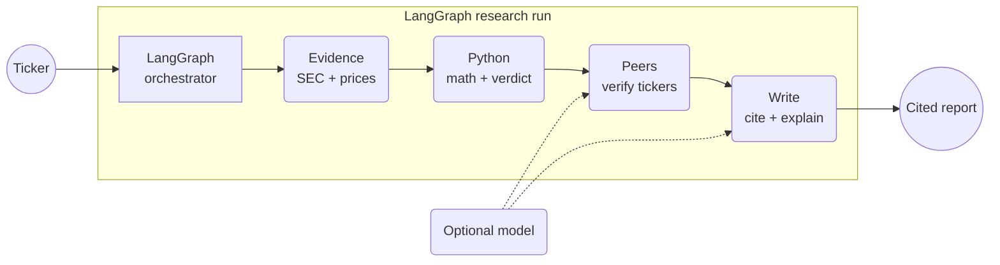

# Ledger agent architecture

One ticker enters one bounded LangGraph run. Four visible steps produce one cited report.

- **Required path:** public evidence, Python calculations, verified peers, cited output.
- **Optional model:** suggests peers and helps write prose; it never owns the numbers.
- **Audit trail:** every result keeps its source, period, and retrieval time.

Open the [white system map](ARCHITECTURE.html).
