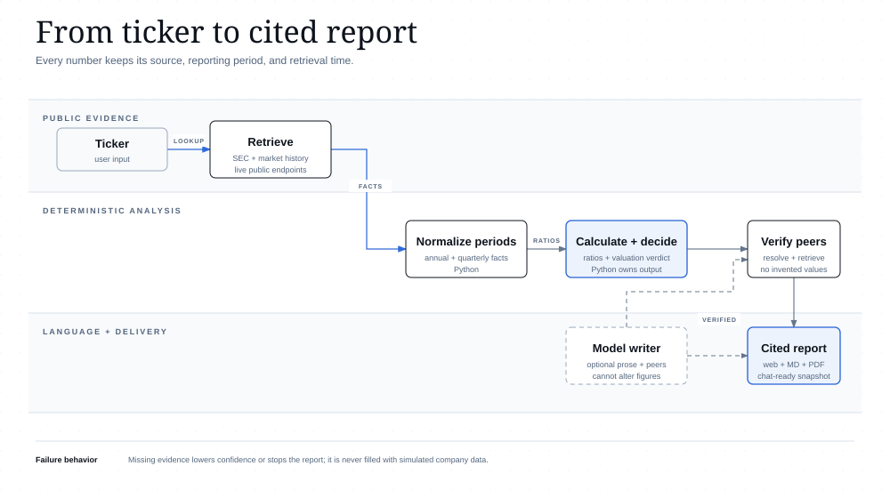
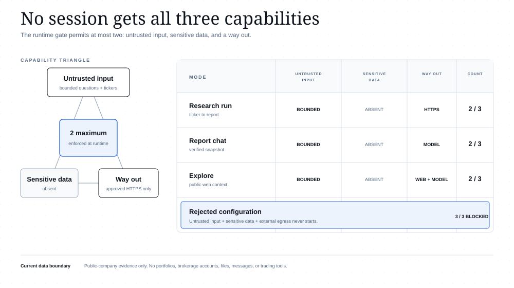

# Ledger architecture

Ledger separates evidence retrieval, deterministic financial analysis, language generation, and
conversation. This keeps the two decisions that matter most - financial calculations and the
valuation verdict - in Python rather than in a model response.

## System boundary

The browser talks only to FastAPI. FastAPI validates input, holds completed reports for 30 minutes,
and routes work into three LangGraph workflows. External services remain outside the local runtime:

- SEC EDGAR and the market-price endpoint provide live public evidence.
- OpenAI is an optional language layer for report writing and Report chat, and the required provider
  for Explore's cited web search.
- LangSmith receives traces only when the user enables it.

The `company-research` graph calls the Python analysis layer for period normalization, ratios,
valuation multiples, confidence, and the final verdict. Model output is validated against the typed
report before it can be displayed or exported.

## Research data flow

The pipeline keeps provenance attached to the facts. Each figure records its source, reporting period,
and retrieval time. A missing evidence path produces lower confidence or a clear error; the workflow
does not manufacture a replacement value.

The optional model can propose candidate peers and turn locked facts into readable prose. Every peer
must still resolve through the SEC index and complete the same evidence retrieval and Python
calculation path. The final memo, Markdown export, PDF export, and Report chat all use the validated
`ResearchReport` snapshot.

## Conversation workflows

**Report chat** receives a run ID and bounded recent history. The server rebuilds a virtual ontology of
`Company`, `ReportRun`, `FinancialMetric`, `ValuationMetric`, `Peer`, `Claim`, and `Source` objects from
the stored snapshot. The answer validator accepts only evidence IDs present in that ontology and
resolves links from the server-held citation map.

**Explore** receives the same locked report context and one public-company question. It calls OpenAI's
Responses API with one provider-hosted web search. The response must contain at least one valid public
HTTP or HTTPS citation. External context cannot mutate the report, recalculate a figure, or change the
verdict.

Both workflows reject URLs and common credential patterns in user questions. Neither exposes shell,
filesystem, database, email, portfolio, brokerage, or arbitrary HTTP tools.

## Access boundary

Every live mode has bounded untrusted input and approved external egress. Sensitive-data access is
absent, so each mode uses two of the three capabilities. `backend/app/security.py` rejects a runtime
profile that enables all three.

Any future feature that handles private portfolios, uploaded files, or persistent user memory must
remove untrusted input or external egress from that same session, or use a reviewed one-way handoff to
a separate boundary.

## Diagram sources

The three diagrams are authored as self-contained HTML with inline SVG and exported to SVG for GitHub:

- [System architecture HTML](diagrams/system-architecture.html)
- [Research data flow HTML](diagrams/research-data-flow.html)
- [Access-triangle matrix HTML](diagrams/access-triangle-matrix.html)

Run `py scripts/generate_docs_diagrams.py` to regenerate the HTML sources. SVG exports are produced
with the installed `diagram-design` skill's exporter and checked with its offline self-check.

[Open all three diagrams](ARCHITECTURE.html).
