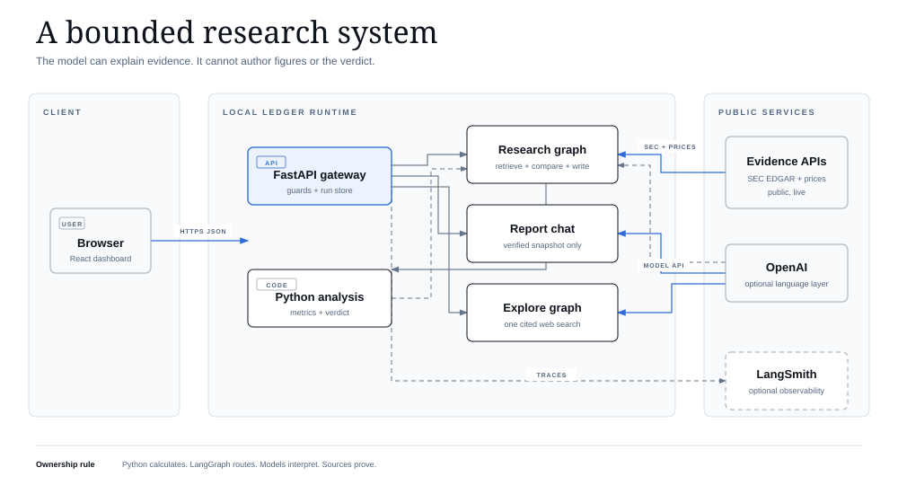

# Company-scoped conversational agent research

Research date: 2026-10-20

## Recommendation

Build the conversation feature as a **read-only, company-scoped agent over the existing `ResearchReport`**, using a small virtual ontology in Python. Do not add Neo4j, RDF, SPARQL, a vector database, or a multi-agent router for the MVP. The report already contains a bounded set of typed objects, relationships, calculations, and source URLs. Treating that contract as the ontology gives the model business meaning without duplicating the data into another store.

The model should explain and connect existing evidence. Python should continue to own every number, the valuation verdict, ticker resolution, scope checks, citation validation, and response acceptance. When no model key is configured, a clearly labelled deterministic answerer may handle fixed report intents; it must use the same ontology facts and must not imitate open-ended model reasoning.

## What the supplied articles and diagrams contribute

The articles are useful design prompts, but they are secondary sources. Their architectural claims were checked against first-party documentation where possible.

| Source | Diagram or central idea inspected | Useful implication for Ledger | Qualification |
| --- | --- | --- | --- |
| [Whither Ontologies?](https://medium.com/@michael.craig.fitzgerald/whither-ontologies-d871bd3a8098) and its [reference implementation](https://github.com/mcfitzgerald/virtual-ontology) | An agent prompt, T-Box/R-Box, and database schema feed a natural-language REPL; it generates SQL against the existing database and retains results for follow-up analysis. | Pair domain meaning with the real data contract instead of first copying data into a graph. For Ledger, the Pydantic report schema is the real data contract, so the agent can receive a compact ontology description plus a report snapshot. | The article demonstrates a prototype on synthetic manufacturing data. It does not establish that free-form SQL generation is safe or necessary here. Ledger should expose no SQL or database tool to the model. |
| [What Is Palantir AIP?](https://www.bdemerson.com/article/what-is-palantir-aip) | A model layer, orchestration layer, and assistant layer grounded by an operational ontology, with permissions, lineage, evaluation, and governed actions. | Keep model access behind a typed context builder and output validator. Preserve the report's existing provenance and trace fields in each answer. | This is a consultancy overview. Palantir's own documentation confirms the core ontology, retrieval, citation, security, and observability primitives cited below. |
| [CodeStrap operating model](https://medium.com/codestrap/the-codestrap-operating-model-for-palantir-foundry-c2e230b7f64a) | A feedback-loop diagram places data integration and modeling south of the ontology, applications and workflows north of it, and business leadership beside the application layer. | Preserve the present module boundary: providers and deterministic analysis build the typed report; the chat experience consumes it. New conversation requirements should change the report contract deliberately rather than leak provider payloads into prompts. | The team-topology advice is organizational opinion, not a runtime requirement. |
| [Beyond Data Silos](https://ai.plainenglish.io/beyond-data-silos-understanding-palantirs-ontology-as-a-complete-operating-model-for-enterprise-5acaca216935) | A three-plane image separates semantic objects, kinetic workflows/rules, and a dynamic model/decision layer. | Model nouns explicitly (`Company`, `Metric`, `Peer`, `Risk`, `Citation`) and encode behavioral rules separately (`cite claims`, `never recalculate`, `stay on the selected company`). | Palantir's official ontology documentation uses **semantic** and **kinetic** elements. The article's additional “dynamic layer” is a helpful editorial model, not a required Palantir abstraction. |
| [Open Ontology SDK article](https://levelup.gitconnected.com/why-im-building-an-open-ontology-sdk-and-what-palantir-got-right-about-ai-orchestration-b68830a6b41f) | One image compares single-agent, multi-agent, fixed LangGraph, and ontology-guided flows. A second places declarative object/link/rule definitions, an ontology engine, and tiered memory before specialist agents. | Inject domain context before the model decides, keep rules deterministic, and scope memory to the current report. The existing LangGraph dependency is sufficient. | The author describes a proposed SDK and roadmap. Its YAML engine, multi-agent layout, and hot/warm/cold memory design are not evidence that Ledger needs those components. |
| [How Ontologies and Graphs Stop LLMs from Hallucinating](https://medium.com/@aiwithakashgoyal/how-ontologies-and-graphs-stop-llms-from-hallucinating-using-annotations-ea8dc34ae6b6) | The main diagram is `query → knowledge graph → ontology rules → retrieve/enrich/generate/verify → answer`. A second summarizes structured-data-to-text approaches. | Use a retrieve/contextualize/generate/verify sequence and reject answers with unknown evidence references. | The diagram's “100% factual” and “0% invented” labels are not defensible guarantees. Retrieval and schemas constrain a model; they do not prove factual entailment. Ledger still needs deterministic checks and honest insufficient-evidence responses. |

## Primary-source findings

Palantir defines its Ontology as an operational layer that maps data and models to real-world objects, properties, and links, and includes kinetic elements such as actions, functions, and dynamic security. This supports using a typed domain layer rather than treating the prompt as the domain model. See [Palantir Ontology overview](https://www.palantir.com/docs/foundry/ontology/overview) and [ontology resources](https://www.palantir.com/docs/foundry/ontologies).

For assistants, Palantir's documented retrieval context is run deterministically on every message and can be limited to selected object properties. Its citation UI links answers back to ontology objects or documents. This supports rebuilding a trusted context packet from the selected report on every turn and returning citation identifiers separately from prose. See [retrieval context](https://www.palantir.com/docs/foundry/chatbot-studio/retrieval-context) and [citations](https://www.palantir.com/docs/foundry/chatbot-studio/citations).

Palantir distinguishes retrieval context from tools. Tools let a model determine control flow or invoke actions, queries, and functions. Ledger does not need tools for report conversation; omitting them reduces latency and preserves the existing no-write security boundary. See [AIP Chatbot tools](https://www.palantir.com/docs/foundry/chatbot-studio/tools).

LangGraph models a workflow through typed state, nodes, and edges; nodes may contain ordinary code rather than an LLM. Its checkpointers provide thread-scoped short-term memory, while stores serve cross-thread long-term memory. This supports a small chat graph and an in-memory checkpointer for the local MVP, without adding PostgreSQL yet. See the [LangGraph Graph API](https://docs.langchain.com/oss/python/langgraph/graph-api), [persistence](https://docs.langchain.com/oss/python/langgraph/persistence), and [memory](https://docs.langchain.com/oss/python/langgraph/add-memory).

LangSmith traces can capture a complete request, including inputs and final output. Palantir likewise warns that agent logs may contain prompts, completions, object properties, and user input. Conversation tracing therefore needs the same public-data boundary as the agent and should avoid secrets or private portfolio content. See the [LangSmith tracing quickstart](https://docs.langchain.com/langsmith/observability-quickstart) and [Palantir log-permission guidance](https://www.palantir.com/docs/foundry/aip-observability/log-permissioning).

Structured output constrains shape, not truth. OpenAI's API documentation says tool arguments can contain parameters the model invented and must be validated by application code; strict JSON Schema support improves schema adherence. Because Ledger uses an OpenAI-compatible endpoint, it should keep Pydantic validation as the portable baseline and opt into provider-specific strict schemas only when supported. See the [OpenAI Chat Completions API](https://platform.openai.com/docs/api-reference/chat).

## Proposed MVP architecture



The system view shows where the conversation modes sit beside the research graph and which external
services they can reach. Report chat uses the verified snapshot only. Explore adds one cited public-web
search while the Python-owned figures and verdict remain immutable.

The graph can use four nodes: `guard_question`, `build_context`, `generate_answer`, and `verify_answer`. The context builder should run on every turn and should read a server-held report snapshot by `run_id`. The browser should send `run_id`, `thread_id`, and the question, not an editable copy of the financial evidence.

The complete report is small enough for the MVP to use a bounded full snapshot instead of embeddings. Omit verbose trace text and model metadata from the model context unless the question asks about methodology. A later document-Q&A feature over filings would be a separate retrieval project with chunk-level citations and evaluation.

## Minimal research ontology

This can remain a Python module backed by Pydantic models; it does not require a graph database.

### Objects

| Object | Identity | Important properties |
| --- | --- | --- |
| `ResearchRun` | `run_id` | generated time, ticker, methodology, confidence, verdict |
| `Company` | ticker | name, exchange; CIK stays provider-resolution metadata unless it is added to `ResearchReport` |
| `ReportingBasis` | run + period end | annual/TTM/prospectus/interim basis, source form, limited-history flag |
| `FinancialMetric` | run + metric key | raw numeric value, unit/format, period, source reference |
| `ValuationMetric` | run + metric key | price, market cap, P/E, price-to-sales, FCF yield, as-of date |
| `PeerCompany` | run + peer ticker | comparable metrics used in the report |
| `ResearchClaim` | run + stable claim key | summary, thesis, risk, or methodology text |
| `EvidenceSource` | run + citation index | label, URL, publisher, retrieval time |
| `ConversationThread` | `thread_id` | selected `run_id`, bounded recent messages |

### Links

- `ResearchRun ANALYZES Company`
- `ResearchRun USES ReportingBasis`
- `ResearchRun HAS FinancialMetric | ValuationMetric | ResearchClaim`
- `ResearchRun COMPARES_WITH PeerCompany`
- `FinancialMetric | ValuationMetric | ResearchClaim SUPPORTED_BY EvidenceSource`
- `ConversationThread SCOPED_TO ResearchRun`

### Rules

1. A thread is immutable to one `run_id`. Changing ticker or rerunning research creates a new thread.
2. The answer may use only properties present in the selected report snapshot and recent messages from that thread.
3. The model may explain supplied values but cannot calculate or replace financial figures, multiples, verdict, or confidence.
4. Each factual answer returns at least one valid `evidence_id`; every identifier is checked against the snapshot allow-list.
5. Citation URLs are rendered from the server-held evidence map, never from a URL generated by the model.
6. If the report does not contain the answer, return a clear limitation and point to the closest relevant filing source.
7. The agent may discuss scenarios only as explicit hypotheticals and may not issue personalized investment instructions, price targets, or trades.
8. No chat node receives browser, shell, filesystem, email, portfolio, trading, database-write, or arbitrary HTTP tools.

## Suggested response contract

```json
{
  "answer": "Concise answer grounded in the selected report.",
  "evidence_ids": ["financials.revenue", "source.0"],
  "answerability": "answered",
  "follow_ups": ["How does that compare with the peer set?"]
}
```

`answerability` should be an enum such as `answered`, `partial`, or `insufficient_evidence`. Pydantic should reject extra fields, unknown evidence IDs, empty evidence for factual answers, overlong output, and malformed follow-ups. The response renderer should resolve evidence IDs into the report's existing source links.

For stronger numeric control, expose canonical metric tokens in the context (`financials.revenue`, `valuation.price_to_sales`) and require the model to list every used token. The validator can then ensure each token exists and attach the correct period/source. This checks provenance and availability; it should not be described as a proof that every sentence is entailed.

## Integration map for this repository

- `backend/app/models.py`: add chat request/response, evidence-reference, and conversation-state models.
- `backend/app/ontology.py`: convert `ResearchReport` into the stable object/evidence map and enforce company-scoped rules.
- `backend/app/conversation.py`: define the four-node LangGraph and a thread-scoped checkpointer.
- `backend/app/llm.py`: add a chat method that accepts the closed context packet and validates the response. Preserve the existing provider-neutral JSON path.
- `backend/app/main.py`: retain completed reports by `run_id` for the process lifetime and expose `POST /api/research/{run_id}/chat`. Unknown or expired runs should return `404`, requiring a fresh research run.
- `src/types.ts`: add chat message and answer types.
- `src/App.tsx`: mount the chat beside or below the active report, reset it on a new run, and show citations as links into the evidence ledger.
- `src/styles.css`: use a restrained report-side conversation panel rather than a floating generic chatbot bubble. Show the selected company and evidence scope in the panel header.

In-memory report and thread stores are acceptable for the local MVP. The UI should say that conversations reset when the server restarts. PostgreSQL belongs in a later authenticated deployment because it introduces retention, user isolation, deletion, and sensitive-data obligations.

## Access triangle and prompt-injection boundary

The chat session keeps the existing two active capabilities:

| Capability | State | Enforcement |
| --- | --- | --- |
| Untrusted input | Enabled | User question is length-limited, treated as data, and never interpreted as permission or code. |
| Sensitive/private data | Disabled | No portfolio, account, user-file, environment, filesystem, or private database context is available. UI states that chat is for public-company questions only. |
| External egress | Enabled | Only the configured model endpoint and optional LangSmith tracing are reachable. The model has no tools. |

The context should contain normalized report fields rather than raw filing HTML. Instructions found in a filing, citation label, company name, or user question cannot override the system rules. Links and evidence identifiers returned by the model are untrusted until matched to the server-side allow-list.

LangSmith should tag chat traces with `ticker`, `run_id`, hashed `thread_id`, answerability, verifier result, citation count, latency, and token counts. Avoid adding environment values or keys to graph state. The UI should disclose that questions and public report context may be sent to the configured model and, when tracing is enabled, LangSmith.

## Evaluation gates

Add a compact, deterministic suite before live model evaluation:

1. AAPL thread cannot read an NVDA report or continue after its `run_id` changes.
2. Unknown evidence IDs fail closed.
3. Every factual accepted answer has a resolvable source URL.
4. Numeric field references resolve to the exact report value and period.
5. Questions requesting portfolio advice, trades, private data, or unsupported future forecasts return a bounded response.
6. Prompt-injection text cannot enable tools, change ticker scope, expose configuration, or suppress citations.
7. Missing model credentials use the labelled deterministic report answerer and make no paid call.
8. Model/provider timeout produces a retryable error without erasing the report.

Then create a small LangSmith dataset of company-scoped questions covering financials, valuation, peers, risks, methodology, citations, insufficient evidence, and adversarial inputs. Use code evaluators for citation validity, ticker isolation, response shape, and forbidden claims; reserve model-based grading for explanation quality and relevance. LangSmith distinguishes offline regression evaluation from online production monitoring and supports deterministic code evaluators alongside model-based graders; see [evaluation types](https://docs.langchain.com/langsmith/evaluation-types).

## Deliberate non-goals

- No general-purpose web research from the chat panel.
- No live SEC or market tool calls during conversation; users rerun research to refresh evidence.
- No graph database, embedding index, or ontology YAML editor.
- No specialist-agent swarm.
- No persistent cross-company or user-profile memory.
- No write actions, trading, alerts, email, or portfolio ingestion.

These constraints make the assistant predictable, fast, inexpensive, and consistent with Ledger's evidence-first security model while leaving a clear path to document retrieval and durable memory after authentication and retention controls exist.
